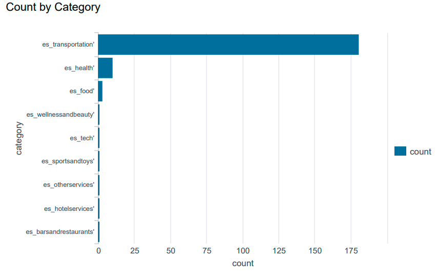
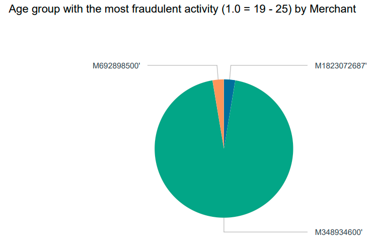

# 📊 Splunk Data Analysis & Financial Fraud Detection
**Virtual Internship Project | Commonwealth Bank (via Forage)**

## 📌 Project Overview
In this project, I used **Splunk Enterprise** to ingest, query, and analyze financial transaction datasets. By writing Search Processing Language (SPL) queries, I identified transaction anomalies, monitored high-risk merchants, and visualized fraudulent payment patterns.

## 🛠️ Tools & Technologies Used
* **SIEM Platform:** Splunk Enterprise
* **Query Language:** Search Processing Language (SPL)
* **Data Sources:** Financial transaction logs, customer demographics, and merchant data

## 🔍 Key Tasks & Technical Implementation
* **Data Ingestion & Indexing:** Ingested financial dataset logs into Splunk for data parsing and indexing.
* **SPL Query Optimization:** Utilized SPL logic (`stats`, `count by`, `eval`) to analyze transaction metrics across business categories and merchant IDs.
* **Demographic Threat Mapping:** Mapped fraudulent activity against customer age groups and gender demographics to identify targeted sectors.
* **Dashboard Visualizations:** Built an interactive dashboard with bar charts, pie charts, and data tables for real-time security monitoring.

## 🖼️ Splunk Visual Analytics & Key Evidence

### 1. Transaction Volume by Category
Visualized event counts across transaction categories using SPL, highlighting significant spikes in the transportation sector (`es_transportation`).

### 2. High-Risk Merchant Correlation (Age Group 19–25)
Correlated high-risk age demographics against targeted merchant IDs to identify concentrated fraudulent transaction activity (notably Merchant `M348934600`).

---

### 📬 Contact
* **LinkedIn:** [vimal-k-0765783a4](https://linkedin.com/in/vimal-k-0765783a4)
* **Email:** vimal.112358@gmail.com
