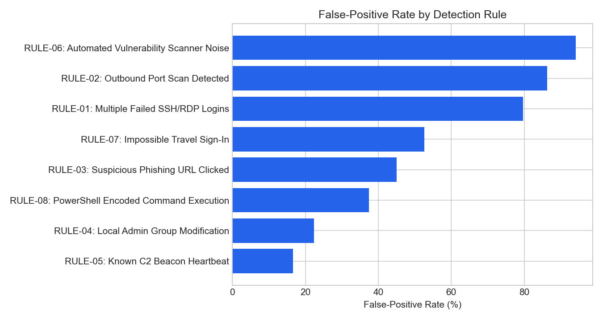
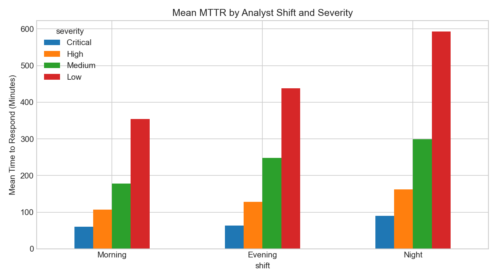
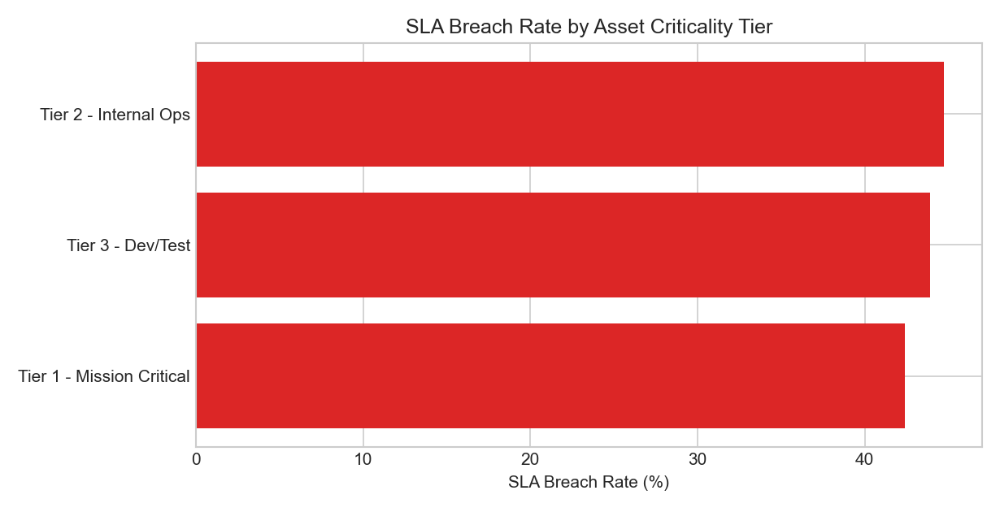
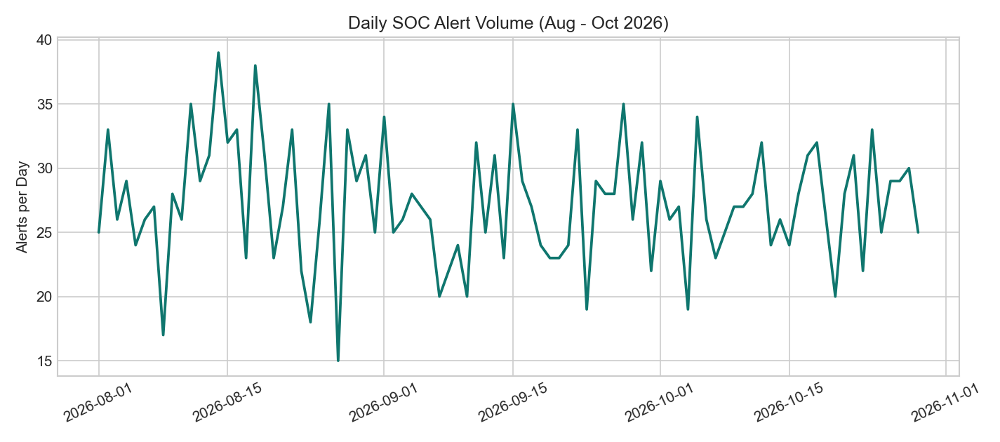

# SOC Alert Triage & SLA Bottleneck Analysis

## 1. Ask
* **Business Problem:** High alert volume, false-positive noise, and shift/tier resolution delays across a 90-day Security Operations Center (SOC) dataset (Aug–Oct 2026) strain analyst capacity and cause frequent SLA breaches.
* **Stakeholders:** SOC Manager (detection tuning, shift coverage, and SLA governance) and Security Engineering / CISO leadership (critical asset protection).
* **Core KPIs:** False-Positive Rate (`fp_pct`), Mean Time to Acknowledge (**MTTA**), Mean Time to Respond (**MTTR**), and SLA Breach Rate (`breach_pct`).

## 2. Prepare
* **Data Architecture:** Relational 3-table telemetry dataset (`alerts.csv`, `assets.csv`, `analysts.csv`) generated via `scripts/generate_soc_data.py` and staged in local SQLite (`data/cleaned/soc_triage.db`).
* **Scope Note:** Synthetic SOC telemetry modeled after realistic enterprise alert distributions and SLA thresholds for reproducible end-to-end portfolio analysis.

## 3. Process
* Removed duplicate alert records (`alert_id` deduplication) and standardized `severity` casing in `scripts/analyze_and_plot.py`.
* Parsed UTC timestamps and filtered incomplete triage chains (`timestamp_utc`, `ack_timestamp_utc`, `resolved_timestamp_utc`).
* Engineered `mtta_mins`, `mttr_mins`, and `sla_breached` (`Critical`: 60m, `High`: 120m, `Medium`: 240m, `Low`: 480m), saving `data/cleaned/cleaned_alerts.csv` and SQLite tables.

## 4. Analyze & 5. Share
* **Overall False-Positive Rate:** `64.7%`
* **Overall SLA Breach Rate:** `43.6%`
* **Top False-Positive Drivers:** `RULE-06: Automated Vulnerability Scanner Noise` (`94.1%` FP across `529` alerts, `455.8m` MTTR) and `RULE-02: Outbound Port Scan Detected` (`86.3%` FP across `357` alerts, `468.4m` MTTR).
* **Critical & Night-Shift Pressure:** `RULE-05` (`54.3%` breach rate, `71.3m` MTTR) and `RULE-04` (`49.2%` breach rate, `69.7m` MTTR) exceed rapid critical response windows, while **Night** shift `Tier 1 - Mission Critical` alerts hit a `62.2%` breach rate (`133.8m` MTTA, `346.1m` MTTR) versus `27.4%` on **Morning** shift.

## 6. Act (Recommendations)
1. **Suppress or Tune Scanner & Port-Scan Noise (`RULE-06`, `RULE-02`):** Allowlist authorized vulnerability scanners and aggregate or threshold low-severity port scans to cut false-positive triage load.
2. **Fast-Track Critical & Tier-1 Queues:** Route `Critical` rules (`RULE-04`, `RULE-05`) and `Tier 1 - Mission Critical` alerts to priority queues with automated context enrichment to lower MTTR and SLA breaches.
3. **Strengthen Night-Shift Coverage & Escalation:** Address Night-shift MTTA (`117.1–140.0m`) and SLA breach rates (`57.5%–64.3%`) through targeted shift coverage, clear escalation thresholds, and automated low-risk noise filtering.
